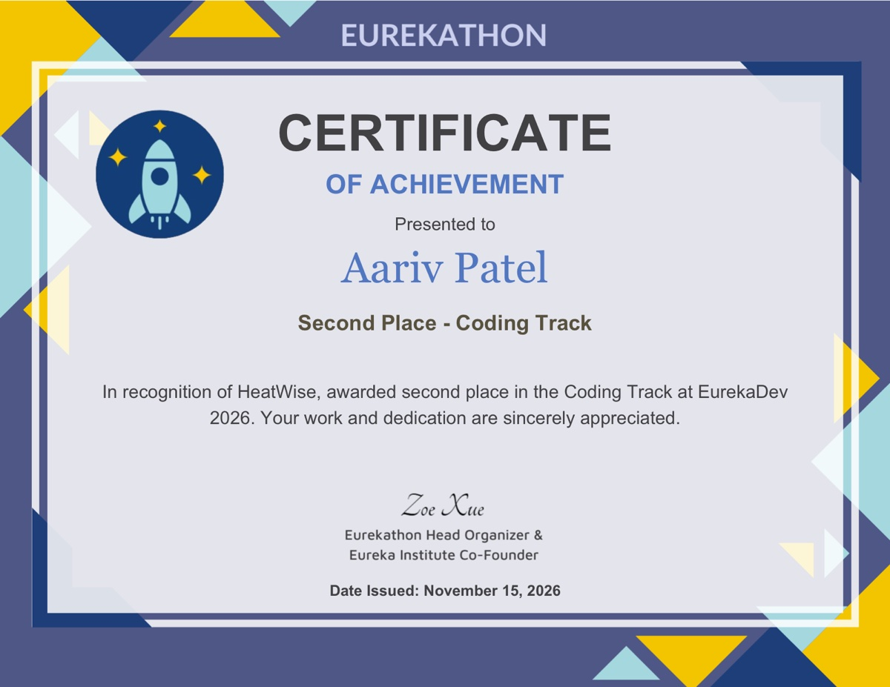
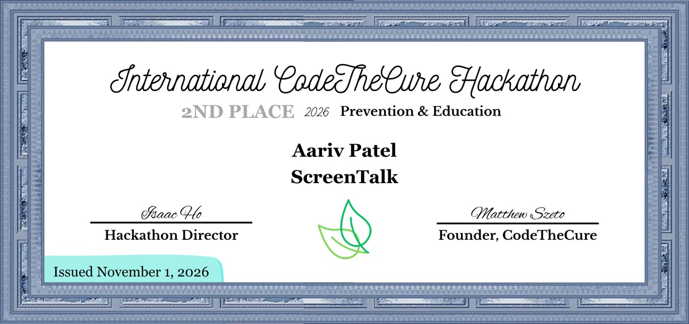

# Aariv Patel

I build apps for the Mac. Most of them are tools for people who work with AI coding agents.

## Awards

<table>
<tr>
<td align="center" valign="top">
 
<b>2nd Place, Coding Track</b> 
EurekaDev 2026 for <a href="https://devpost.com/software/heatwise">HeatWise</a>
</td>
<td align="center" valign="top">
 
<b>2nd Place, Prevention and Education</b> 
International CodeTheCure Hackathon 2026 for <a href="https://devpost.com/software/screentalk-btpo84">ScreenTalk</a>
</td>
</tr>
</table>

- **Flisk Founding Contributor #12 of 100** and Hall of Fame (6 kyu, 10 merged pull requests to [flisk-sh/flisk](https://github.com/flisk-sh/flisk))

More hackathon projects are on [Devpost](https://devpost.com/draarivpatel-ui).

## Open source

41 merged pull requests to 19 projects by other people, including [apache/iggy](https://github.com/apache/iggy), [assimp/assimp](https://github.com/assimp/assimp), [MobilityData/gtfs-validator](https://github.com/MobilityData/gtfs-validator) and [markdownlint-cli](https://github.com/igorshubovych/markdownlint-cli).

## Projects

**[Regatta](https://github.com/draarivpatel-ui/regatta)**
Runs several AI coding agents at once on macOS, with safety rails for operations that change a repository.

**[Armillary](https://github.com/draarivpatel-ui/armillary)**
A local-first Mac app that keeps the session history of every AI coding agent you use in one place.

**[wasitme](https://github.com/draarivpatel-ui/wasitme)**
Was it me, or the model? A timeline of what changed in your Claude Code and Codex sessions.

**[Busyholm](https://github.com/draarivpatel-ui/busyholm)**
A papercut river island along the bottom of your screen that grows as your AI coding agents work.

**[Foldertrail](https://github.com/draarivpatel-ui/foldertrail)**
Turns a Garmin BaseCamp library into GPX files in the same folders, in the browser. The source is published for reference.
